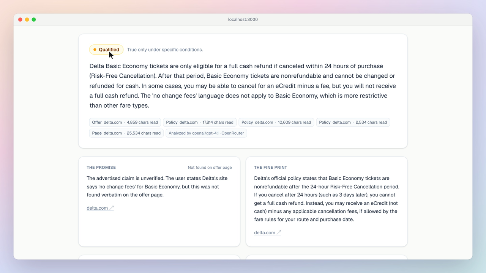
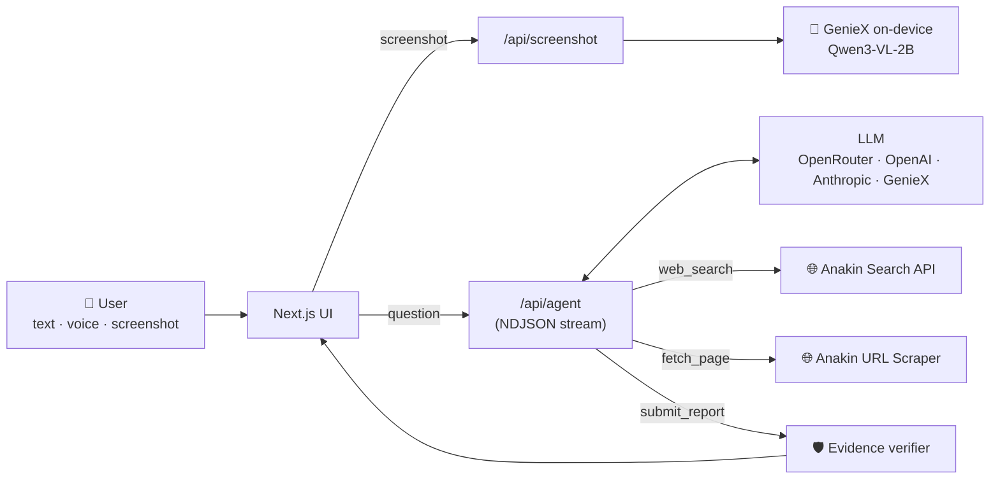

<div align="center">

# 🔍 PromiseProof

### Know the fine print *before* you pay.

An AI research agent that checks travel deals' cancellation and refund promises against the provider's **live, official terms**, and backs every finding with quotes it has verified word-for-word.

[🎬 Demo video](https://drive.google.com/file/d/165ZpCZd6ZquuaSfA50Q-TqmYAO-2QcBK/view?usp=sharing) · [⚡ Quick start](#-quick-start) · [🏗️ Architecture](#️-architecture) · [🛡️ Trust & safety](#️-trust--safety) · [🧪 Testing](#-testing)

     



</div>

---

## 😤 The problem

"**Free cancellation.**" "**No change fees.**" "**Fully refundable.**"

Travel offers lead with promises like these, but the conditions sit in a separate policy page: 24-hour windows, fare-class exclusions, "eCredit, not cash", deadlines tied to the property's local time. Most travelers only discover these rules **after** they've paid and need to cancel.

PromiseProof is for **anyone booking a flight, hotel, or package** who wants a straight answer, with proof, before they pay.

## ✨ What it does

| | Feature | |
|---|---|---|
| 🗣️ | **Ask in plain English** | Type or dictate a question (works with system-wide dictation like Wispr Flow). Links are optional. |
| 🤖 | **Agentic research** | A tool-calling agent searches the web, finds the provider's *official* policy pages, and reads them live. You watch each step stream in. |
| ⚖️ | **Clear verdict** | `SUPPORTED` · `QUALIFIED` · `CONTRADICTED` · `UNVERIFIED`, with the promise and the fine print side by side. |
| 🔒 | **Verified quotes only** | Every quote is matched against the scraped page text. If the AI invents a quote, it's discarded, and a verdict with no verified policy quote is downgraded to `UNVERIFIED`. |
| 📸 | **Screenshot input, read on-device** | Attach or paste a screenshot of a deal. **Qualcomm GenieX** reads it with a local vision model, so your booking details never leave your machine. |
| 🔗 | **Compare two pages** | Already have the offer and policy URLs? Compare them directly. |
| ✅ | **Actionable output** | Important conditions, open questions to ask the provider, and practical next steps. |

### Verdicts

| Status | Meaning |
|---|---|
| 🟢 `SUPPORTED` | Published terms clearly back the claim. |
| 🟡 `QUALIFIED` | True only with meaningful conditions, fees, or deadlines. |
| 🔴 `CONTRADICTED` | Published terms conflict with the claim. |
| ⚪ `UNVERIFIED` | Relevant official terms couldn't be found, read, or verified. |

## 🎬 Demo

> 📹 **[Watch the 35-second demo](https://drive.google.com/file/d/165ZpCZd6ZquuaSfA50Q-TqmYAO-2QcBK/view?usp=sharing)**: a Delta Basic Economy question → live agent research → a **Qualified** verdict with verified quotes → a Booking.com screenshot read on-device by GenieX.

The video was recorded from the running app by [`videos/record.mjs`](videos/record.mjs) using the scripted take in [`videos/demos/promiseproof.mjs`](videos/demos/promiseproof.mjs). Waiting periods are time-lapsed and labelled "sped up" on screen.

## ⚡ Quick start

**Prerequisites:** Node.js 20+, an [Anakin](https://anakin.io) API key, and one LLM key (Anthropic, OpenAI, or OpenRouter). For the screenshot feature you also need Docker and GenieX (see [GenieX setup](#-geniex-on-device-setup)).

```bash
git clone https://github.com/itsnaveenk/ProofInvestigator.git
cd ProofInvestigator
cp .env.example .env.local   # add your keys
npm install
npm run dev                  # → http://localhost:3000
```

### 🔑 Environment

All keys stay **server-side** and are never sent to the browser.

| Variable | Required | Purpose |
|---|---|---|
| `ANAKIN_API_KEY` | ✅ | Anakin URL Scraper and Search API. |
| `ANTHROPIC_API_KEY` / `OPENAI_API_KEY` / `OPENROUTER_API_KEY` | One of them ✅ | Hosted LLM. Anthropic is preferred if set; `sk-or-…` keys are routed to OpenRouter automatically. |
| `LLM_MODEL` | — | Hosted model override. Defaults: `claude-sonnet-5-5`, `gpt-4.1`, `openai/gpt-4.1`. |
| `GENIEX_BASE_URL` | — | GenieX server, default `http://127.0.0.1:18181/v1`. |
| `GENIEX_VLM_MODEL` | 📸 | Vision model for screenshots, e.g. `unsloth/Qwen3-VL-2B-Instruct-GGUF:Q4_0`. |
| `GENIEX_AGENT_MODEL` | — | e.g. `unsloth/Qwen3-4B-Instruct-2507-GGUF:Q4_0`. Runs the agent **fully on-device**; no hosted key needed. |

## 🧭 How to use it

1. **🤖 Ask the agent** (default tab): describe the deal and your question, or click an example. Press **Investigate** and watch the agent search and read pages.
2. **📸 Screenshot**: click **Attach screenshot** or paste an image into the box. GenieX extracts the provider, the offer, and the cancellation wording, then fills in a question for you to review.
3. **🔗 Compare two pages**: paste an offer URL, a policy URL, and the claim.

## 🏗️ Architecture



```text
src/
├── app/
│   ├── page.tsx                  UI: agent + compare modes, live trace, report
│   └── api/
│       ├── agent/route.ts        POST {query} → NDJSON stream of agent events
│       ├── investigate/route.ts  POST {offerUrl, policyUrl, claim} → JSON report
│       └── screenshot/route.ts   POST {image} → extracted offer + question (GenieX)
└── lib/
    ├── agent.ts                  Tool-calling agent loop
    ├── llm.ts                    Provider selection + one OpenAI-compatible client
    ├── analyze.ts                Excerpt selection, report schema, evidence verification
    ├── anakin.ts                 Anakin scraper (with polling) and search clients
    └── safeUrl.ts                SSRF guard
scripts/check.mts                 Sanity checks (synthetic fixtures)
videos/                           Demo recorder + scripted take
test-results/                     Raw outputs from live runs
```

### 🤖 The agent

A tool-calling loop ([`src/lib/agent.ts`](src/lib/agent.ts)) with three tools:

| Tool | Backed by | Notes |
|---|---|---|
| `web_search(query)` | Anakin Search API (`POST /v1/search`) | Finds official policy pages. Results are leads, never evidence. |
| `fetch_page(url, focus)` | Anakin URL Scraper | Returns the parts relevant to `focus`; the full text is kept server-side for verification. |
| `submit_report(...)` | Schema-validated output | Ends the run; then passes through the evidence verifier. |

- **Limits:** 10 turns / 5 page reads (hosted); 6 turns / 3 reads with smaller excerpts (on-device).
- Independent tool calls run in parallel, and the same page is never fetched twice.
- Events (`model`, `step`, `step_done`, `result`, `error`) stream to the UI as NDJSON.

### 🌐 Live web data with Anakin

- `POST /v1/url-scraper/scrape` with `X-API-Key`. Job `status` is checked explicitly, because failed jobs can return HTTP 200.
- A `202` or still-processing job is polled via `GET /v1/url-scraper/{id}` within a time budget.
- Thin or empty content triggers a retry with `useBrowser: true` for JavaScript-heavy sites.
- A target HTTP status ≥ 400, an empty page, or a timeout is reported as a **retrieval failure** and never replaced with mock data.

### 🧠 LLM providers

Every model, hosted or local, goes through **one OpenAI-compatible client** ([`src/lib/llm.ts`](src/lib/llm.ts)). Selection order: `GENIEX_AGENT_MODEL` → `ANTHROPIC_API_KEY` → `OPENAI_API_KEY` / `OPENROUTER_API_KEY`. Local-model quirks are handled: GenieX ignores `tool_choice`, so the report is also requested in the prompt, and fenced JSON replies are accepted.

## 🛡️ Trust & safety

| | Guardrail |
|---|---|
| 🔒 | **Verified evidence.** Each quote is matched, after normalizing whitespace and markdown, against the full text of the page it cites. Non-matching quotes are dropped and counted in the report. |
| ⚖️ | **No verdict without proof.** Anything other than `UNVERIFIED` needs at least one verified policy quote. |
| 🏷️ | **Claim provenance.** "Found on offer page" is shown only when a verified offer-page quote backs it. |
| 🚫 | **No invented terms.** If a page can't be retrieved, the app reports that and never substitutes mock content. |
| 💉 | **Prompt-injection aware.** Scraped pages and search results are wrapped as untrusted data, and the model is told never to follow instructions inside them. |
| 🌐 | **SSRF guard.** URLs must be http(s), use standard ports, contain no credentials, and resolve only to public IPs. Redirect targets are re-checked. |
| 🔐 | **Private by design.** No accounts, database, or history. Screenshots are processed on-device by GenieX. |

## 📱 GenieX on-device setup

[GenieX](https://github.com/qualcomm/GenieX) is Qualcomm's on-device AI runtime. On Snapdragon it runs on the NPU; on Apple Silicon it runs **CPU-only in Docker**:

```bash
git clone --depth 1 https://github.com/qualcomm/GenieX.git && cd GenieX
docker build -f .github/docker/cpu-host.Dockerfile -t geniex-cpu-host .
docker run -d --name geniex -p 127.0.0.1:18181:18181 -v "$PWD/data:/data" \
  -e GENIEX_NCTX=16384 -e GENIEX_THINK=false geniex-cpu-host geniex serve --host 0.0.0.0:18181
docker exec geniex geniex pull unsloth/Qwen3-VL-2B-Instruct-GGUF:Q4_0 --model-type vlm
docker exec geniex geniex pull unsloth/Qwen3-4B-Instruct-2507-GGUF:Q4_0   # optional: local agent
```

> 💡 Models are stored inside the container. Use `docker start geniex` to reuse it instead of recreating it. `GENIEX_NCTX` raises the context window from the 4,096-token default.

**📊 Measured on an M1 Pro (8 Docker CPUs, CPU only):**

| Workload | Model | Result |
|---|---|---|
| 📸 Screenshot reading | Qwen3-VL-2B (Q4_0) | ✅ ~22–24 s per image |
| 🤖 Full agent on-device | Qwen3-4B-Instruct-2507 (Q4_0) | ✅ correct tool calls and official pages, but ~85 s per turn (≈5–6 min per question) |
| 🤖 Full agent, hosted | GPT-4.1 via OpenRouter | ✅ ~24 s per question |

That's why the demo uses a hosted LLM for the agent and GenieX for screenshots. On a Snapdragon NPU, setting `GENIEX_AGENT_MODEL` runs everything on-device.

## 🧪 Testing

```bash
node scripts/check.mts   # evidence matching, verdict downgrade, SSRF, JSON parsing, provider selection
npm run lint             # ESLint
npm run build            # type-check + production build
```

**Live scenarios against real public pages** (raw outputs in [`test-results/`](test-results/)):

| File | Mode | Scenario | Result |
|---|---|---|---|
| `s1.json` | 🔗 Compare | Delta "no change fees" vs. Main Cabin refund | 🟡 `QUALIFIED` |
| `s2.json`, `s2-recheck.json` | 🔗 Compare | Basic Economy "full cash refund any time" | 🔴 `CONTRADICTED` |
| `s3.json`, `s3b.json` | 🔗 Compare | Policy URL is a soft-404 (Delta, Booking.com) | ⚪ `UNVERIFIED` |
| `a1.ndjson` | 🤖 Agent | Delta Basic Economy refund after 3 days | 🟡 `QUALIFIED` |
| `a2.ndjson` | 🤖 Agent | Booking.com "free cancellation" | 🟡 `QUALIFIED` |
| `a3.ndjson` | 🤖 Agent | Off-topic (weather) | ⚪ `UNVERIFIED`, scope explained |
| `demo-warmup.ndjson` | 🤖 Agent | Demo query | 🟡 `QUALIFIED`, 4 verified quotes, 24 s |
| `screenshot-run*.json` | 📸 Screenshot | Real Booking.com results page | Extracted "Free cancellation" |

## ⚠️ Known limitations

- 🎯 Scope is travel cancellation and refund claims.
- ⏱️ Hosted agent runs take 20–40 s; the agent often uses its full page budget.
- 🐢 CPU-only GenieX on a Mac is slow; a fully on-device agent is practical on a Snapdragon NPU.
- 🎲 The small vision model's output varies between runs. Only cancellation, refund, and payment wording is kept, and you review the question before it runs.
- 🕳️ Some sites return "page not found" with HTTP 200; the LLM, not the scraper, catches these and returns `UNVERIFIED`.
- 🧵 Requests run synchronously within one HTTP call (`maxDuration` 300 s); there's no job queue.

## 🛠️ Built with

- **[Next.js 16](https://nextjs.org) + TypeScript + Tailwind CSS 4.** No database or auth, and no runtime dependencies beyond Next.js and React.
- **[Anakin](https://anakin.io).** Live web search and scraping.
- **[Qualcomm GenieX](https://github.com/qualcomm/GenieX).** On-device vision and LLM inference.
- **[Wispr Flow](https://wisprflow.ai).** Voice dictation, used to build the project and to ask questions in the app.
- **OpenRouter / OpenAI / Anthropic.** Hosted LLMs, all called through one OpenAI-compatible client.

---

<div align="center">

Built by **Team 4Pizzas** 🍕🍕🍕🍕 at the Speed of Thought Meetup.

<sub>PromiseProof summarizes published terms. It is not legal advice. Always confirm with the provider before you pay.</sub>

</div>
